# Vehicle Companion

> **Comprehensive Vehicle Lifecycle & Maintenance Management Platform**


**Vehicle Companion** is a centralized, responsive web platform designed to digitize and manage the full lifecycle of personal and commercial vehicles. It provides multi-role portals for **Vehicle Owners**, **Mechanics/Garages**, and **Insurance Officers**, bringing vehicle specifications, service logs, fuel expenditure analytics, automated maintenance reminders, policy expiration tracking, GPS emergency assistance, and interactive garage discovery into one unified system.

---

## Table of Contents

1. [Project Overview](#1-project-overview)
2. [Problem Statement](#2-problem-statement)
3. [Proposed Solution](#3-proposed-solution)
4. [Project Objectives](#4-project-objectives)
5. [Target Users & Role Comparison Matrix](#5-target-users--role-comparison-matrix)
6. [Technology Stack](#6-technology-stack)
7. [Technology Selection Rationale](#7-technology-selection-rationale)
8. [System Architecture](#8-system-architecture)
9. [Complete Application Flow](#9-complete-application-flow)
10. [Authentication Flow](#10-authentication-flow)
11. [Authorization & Role-Based Access Controls](#11-authorization--role-based-access-controls)
12. [Database Design & ER Diagram](#12-database-design--er-diagram)
13. [Row Level Security (RLS) & Security Policy](#13-row-level-security-rls--security-policy)
14. [Module-Wise Technical Documentation](#14-module-wise-technical-documentation)
15. [Vehicle Management (CRUD)](#15-vehicle-management-crud)
16. [Vehicle Details Architecture](#16-vehicle-details-architecture)
17. [Service Management Workflow](#17-service-management-workflow)
18. [Fuel Expense Management & Analytics](#18-fuel-expense-management--analytics)
19. [Maintenance Schedule & Status Calculation](#19-maintenance-schedule--status-calculation)
20. [Insurance Tracking & Expiry Logic](#20-insurance-tracking--expiry-logic)
21. [Emergency Assistance & GPS Geolocation](#21-emergency-assistance--gps-geolocation)
22. [Nearby Garage Finder & Leaflet Maps](#22-nearby-garage-finder--leaflet-maps)
23. [Mechanic & Garage Portal Workflow](#23-mechanic--garage-portal-workflow)
24. [Insurance Company Portal Workflow](#24-insurance-company-portal-workflow)
25. [Dashboard Architecture & Calculations](#25-dashboard-architecture--calculations)
26. [Data Flow Diagrams (DFD)](#26-data-flow-diagrams-dfd)
27. [API & Backend Communication Architecture](#27-api--backend-communication-architecture)
28. [Business Logic, Methods & Formulas](#28-business-logic-methods--formulas)
29. [Input Validation & Error Handling Strategy](#29-input-validation--error-handling-strategy)
30. [Project Directory Structure](#30-project-directory-structure)
31. [Environment Variables & Credentials Security](#31-environment-variables--credentials-security)
32. [Local Setup & Installation Guide](#32-local-setup--installation-guide)
33. [Database Provisioning & SQL Setup](#33-database-provisioning--sql-setup)
34. [Production Deployment (Vercel)](#34-production-deployment-vercel)
35. [Production Build & Verification Results](#35-production-build--verification-results)
36. [Complete Testing Strategy & Matrix](#36-complete-testing-strategy--matrix)
37. [Security Architecture](#37-security-architecture)
38. [Responsive Design & Mobile Usability](#38-responsive-design--mobile-usability)
39. [Complete User Journeys](#39-complete-user-journeys)
40. [Mermaid System Flowcharts Directory](#40-mermaid-system-flowcharts-directory)
41. [External Services Integration](#41-external-services-integration)
42. [Limitations](#42-limitations)
43. [Future Roadmap & Enhancements](#43-future-roadmap--enhancements)
44. [Advantages & Practical Benefits](#44-advantages--practical-benefits)
45. [Use Cases & Walkthroughs](#45-use-cases--walkthroughs)
46. [Input ➔ Process ➔ Output (IPO) Matrix](#46-input--process--output-ipo-matrix)
47. [Technical Glossary](#47-technical-glossary)
48. [Viva & Presentation Q&A Guide](#48-viva--presentation-qa-guide)
49. [Key Code Snippets](#49-key-code-snippets)
50. [Project Status & Quick Reference](#50-project-status--quick-reference)

---

## 1. Project Overview

### Simple Explanation
**Vehicle Companion** is a digital record-keeper and assistant for vehicle owners, mechanics, and insurance agents. Instead of keeping physical paper bills in a glovebox or guessing when an oil change is due, owners can log their vehicles, record fuel fill-ups, track service invoices, receive automatic warnings before insurance policies expire, request emergency roadside help with GPS coordinates, and locate nearby mechanics on a map.

### Technical Explanation
Technically, **Vehicle Companion** is a Single Page Application (SPA) built with **React 18** and **Vite**, styled using **Tailwind CSS**, and backed by **Supabase (PostgreSQL 15)**. The application implements role-based access control (RBAC) separating Vehicle Owners, Mechanics, and Insurance Officers. Data security is enforced at both the client route level (`RoleRoute.jsx`) and the database layer using PostgreSQL **Row Level Security (RLS)**. Visualization is handled by **Recharts**, interactive mapping relies on **Leaflet** with **OpenStreetMap** tiles, and real-time location capture uses the browser's native **Geolocation API** (`navigator.geolocation`).

---

## 2. Problem Statement

Vehicle ownership involves multiple disjointed activities that cause friction and financial loss:

1. **Scattered Vehicle Records**: Paper receipts for repairs, physical insurance papers, and manual mileage notes are easily misplaced.
2. **Untracked Fuel Expenses**: Drivers lack real-time visibility into monthly fuel inflation, cost per kilometer, or overall fuel consumption patterns.
3. **Missed Maintenance Deadlines**: Engine oil degradation, worn brake pads, and tire rotation schedules are frequently forgotten, leading to costly engine or transmission failure.
4. **Lapsed Insurance Coverage**: Missing an insurance renewal date leads to legal fines, voided claims during accidents, and increased renewal premiums.
5. **Highway Breakdown Distress**: Stranded motorists struggle to share exact latitude/longitude coordinates with roadside assistance or find open garages in unfamiliar locations.
6. **Lack of Stakeholder Coordination**: Vehicle owners, repair technicians, and insurance adjusters communicate via unorganized phone calls without a shared record of truth.

---

## 3. Proposed Solution

Vehicle Companion resolves these challenges through a unified cloud platform:

- **Centralized Registry**: Maintains complete specifications, registration details, mileage, and fuel types for personal or commercial fleets.
- **Automated Alerts**: Computes dynamic status flags (`Upcoming`, `Due Soon`, `Overdue`, `Active`, `Expiring Soon`, `Expired`) based on real-time date comparisons.
- **Visual Analytics**: Aggregates individual fuel receipts into monthly expenditure charts via Recharts.
- **GPS SOS Emergency System**: Captures exact device GPS coordinates to dispatch roadside emergency requests.
- **Interactive Garage Finder**: Displays nearby verified service centers on an OpenStreetMap interface with direct driving route integration.
- **Tri-Portal Ecosystem**: Provides dedicated, permission-scoped dashboards for Owners, Mechanics, and Insurance Providers.

---

## 4. Project Objectives

1. **Centralize Vehicle Data**: Store technical specifications, registration numbers, manufacturing years, and odometer readings in a single schema.
2. **Digitize Service History**: Provide digital logging of service types, technician notes, repair dates, and costs.
3. **Track Fuel Expenditure**: Automatically calculate total costs (`quantity × price_per_litre`) and visualize monthly trends.
4. **Automate Maintenance Alerts**: Provide automatic status calculations for tasks due within 7 days or past due dates.
5. **Monitor Insurance Expiration**: Provide 30-day early warnings prior to policy expiration dates.
6. **Enable Emergency Roadside SOS**: Capture live GPS coordinates (`latitude`, `longitude`) for breakdown support requests.
7. **Map Nearby Garages**: Render interactive Leaflet maps with custom markers, service offerings, ratings, and direction links.
8. **Enforce Role-Based Governance**: Isolate Owner, Mechanic, and Insurance capabilities via RBAC and RLS.
9. **Ensure Cloud Persistence**: Connect frontend components to Supabase PostgreSQL with reactive local storage fallback for offline demo readiness.
10. **Deliver Mobile Responsiveness**: Provide fluid layouts across mobile drawers, tablet grids, and desktop sidebars.

---

## 5. Target Users & Role Comparison Matrix

### User Roles Implemented

1. **Vehicle Owner (`owner`)**:
   - Manages personal vehicle fleet.
   - Registers vehicles, logs fuel, schedules maintenance, views service logs.
   - Initiates GPS emergency assistance requests and browses nearby garages.

2. **Mechanic (`mechanic`)**:
   - Manages workshop repair pipeline.
   - Views assigned customer vehicles and incoming service requests.
   - Updates service status (`Requested` ➔ `In Progress` ➔ `Completed`) and logs technician notes.

3. **Insurance Provider (`insurance`)**:
   - Oversees corporate insurance policies.
   - Views policy directories, monitors active vs. expiring policies, updates policy status.

### Role Comparison Matrix

| Feature Module | Vehicle Owner | Mechanic | Insurance Officer |
| :--- | :---: | :---: | :---: |
| **Owner Dashboard** | Full Access | Redirected | Redirected |
| **Mechanic Dashboard** | Redirected | Full Access | Redirected |
| **Insurance Dashboard** | Redirected | Redirected | Full Access |
| **Vehicle CRUD** | Create / Read / Update / Delete (Own) | Read Only (Assigned) | Read Only (Assigned) |
| **Service History** | Create / Read | Create / Update Status | Read Only |
| **Fuel Tracking** | Create / Read | No Access | No Access |
| **Maintenance Alerts** | Create / Read / Mark Done | Update Status | No Access |
| **Insurance Policies** | Read (Own Vehicle) | No Access | Create / Read / Update |
| **Emergency SOS** | Create / Read Status | View / Update Status | No Access |
| **Garage Map** | Full Access | Read Only | Read Only |

---

## 6. Technology Stack

### Frontend Core
- **React (v18.3.1)**: Component-based UI library powering declarative view rendering.
- **Vite (v5.2.11)**: Next-generation frontend tooling providing lightning-fast HMR and optimized Rollup production bundling.
- **JavaScript (ES6+)**: Language standard utilizing Async/Await, ES Modules, Destructuring, and Promises.

### Styling & UI
- **Tailwind CSS (v3.4.3)**: Utility-first CSS framework for responsive layout design.
- **PostCSS (v8.4.38) & Autoprefixer (v10.4.19)**: CSS transformation pipeline for vendor prefixing.
- **Lucide React (v0.395.0)**: Icon system providing clean vector icons (`Car`, `Wrench`, `ShieldCheck`, `Fuel`, etc.).
- **clsx & tailwind-merge**: Class utility functions for conditional class joining.

### Routing & State Management
- **React Router DOM (v6.23.1)**: Client-side routing library supporting nested routes, route guards, and URL parameters.
- **React Context API (`AuthContext.jsx`)**: Centralized auth state provider managing user sessions, roles, and profiles.

### Backend & Database (BaaS)
- **Supabase (`@supabase/supabase-js` v2.45.0)**: Open-source Firebase alternative providing managed PostgreSQL, Auth, and RLS.
- **PostgreSQL (v15)**: Relational database engine supporting foreign key constraints, check constraints, and UUID generation (`uuid-ossp`).

### Visualization & Maps
- **Recharts (v2.12.7)**: Composably SVG-based chart library for rendering responsive fuel spend bar charts.
- **Leaflet (v1.9.4) & React-Leaflet (v4.2.1)**: Mobile-friendly interactive mapping library.
- **OpenStreetMap**: Open-source tile layer provider rendering map graphics.
- **Browser Geolocation API**: HTML5 Web API (`navigator.geolocation`) capturing latitude/longitude coordinates.

---

## 7. Technology Selection Rationale

- **Why React + Vite?** Vite eliminates slow cold-starts by serving source code over native ESM, while React's virtual DOM ensures smooth UI updates when state changes.
- **Why Tailwind CSS?** Utility classes eliminate bulky custom CSS files, enabling design consistency through custom color palettes (`brand-50` to `brand-950`).
- **Why Supabase & PostgreSQL?** Relational structure is mandatory for linking users to vehicles, service records, fuel logs, and policies. Supabase handles authentication and instant API endpoints out of the box.
- **Why Row Level Security (RLS)?** Client-side route guards can be bypassed by malicious users inspecting network requests. Database RLS guarantees that data access rules are executed inside PostgreSQL itself.
- **Why Leaflet + OpenStreetMap?** Provides an open-source, non-proprietary interactive mapping solution without requiring expensive proprietary API keys.
- **Why Recharts?** Native React wrapper over D3 that automatically recalculates chart dimensions inside responsive container elements.

---

## 8. System Architecture

The application follows a layered client-server architecture. The browser renders the React SPA, which communicates directly with Supabase services via standard HTTP/REST endpoints over TLS.

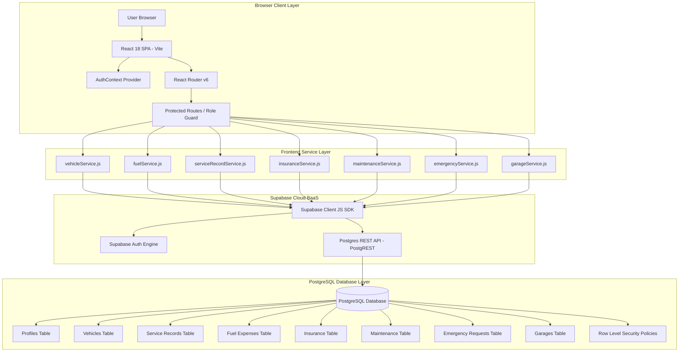

---

## 9. Complete Application Flow

The overall user operational flow moves from initial landing page authentication to role determination, followed by access to role-scoped module dashboards.

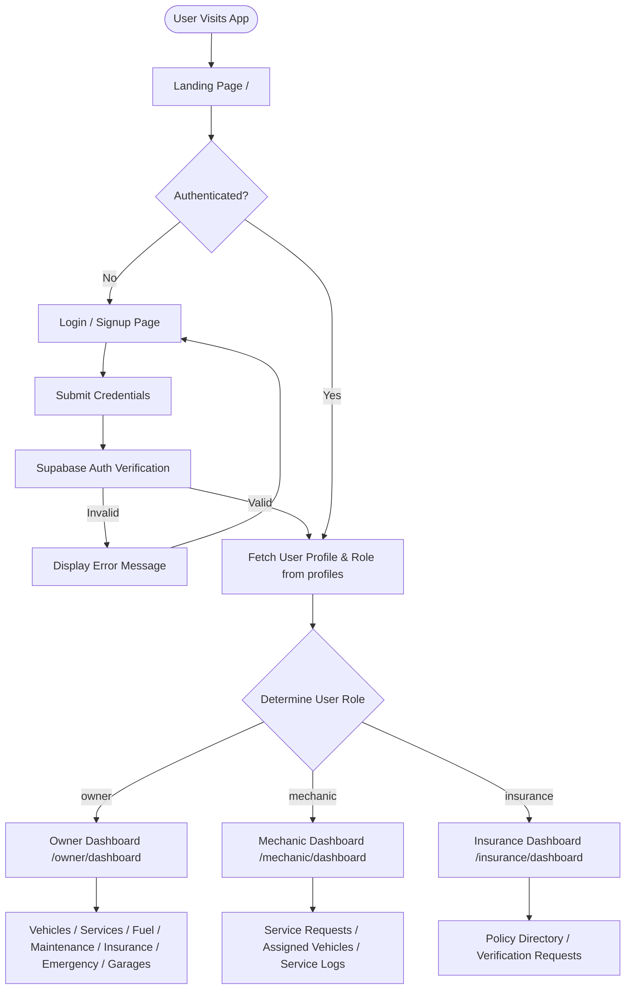

---

## 10. Authentication Flow

Authentication is powered by Supabase Auth with fallback demo profile matching.

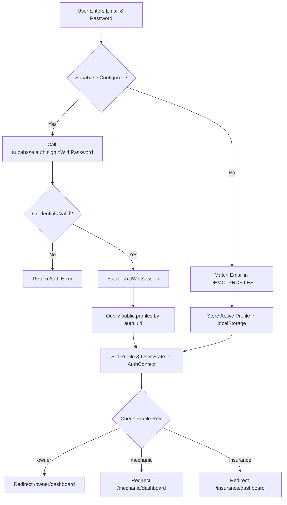

---

## 11. Authorization & Role-Based Access Controls

Authorization is enforced at two distinct boundaries:

1. **Client-Side Route Guards**:
   - `ProtectedRoute.jsx`: Redirects unauthenticated users to `/login`.
   - `RoleRoute.jsx`: Checks `profile.role` against `allowedRoles`. If an Owner attempts to open `/mechanic/dashboard`, `RoleRoute` intercepts the navigation and redirects them back to `/owner/dashboard`.

2. **Database-Side Row Level Security (RLS)**:
   - PostgreSQL RLS policies restrict SQL queries execution based on `auth.uid()`. Even if an owner makes a raw HTTP POST request to modify another owner's vehicle ID, PostgreSQL rejects the statement.

---

## 12. Database Design & ER Diagram

The database consists of 8 relational tables linked via PostgreSQL foreign key constraints (`ON DELETE CASCADE` / `ON DELETE SET NULL`).

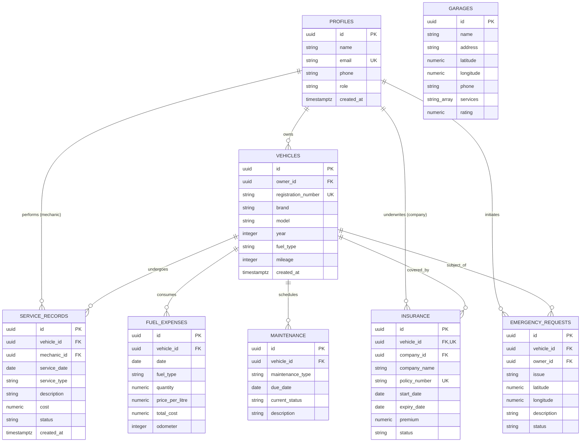

---

## 13. Row Level Security (RLS) & Security Policy

RLS is enabled on all tables in `supabase_schema.sql`.

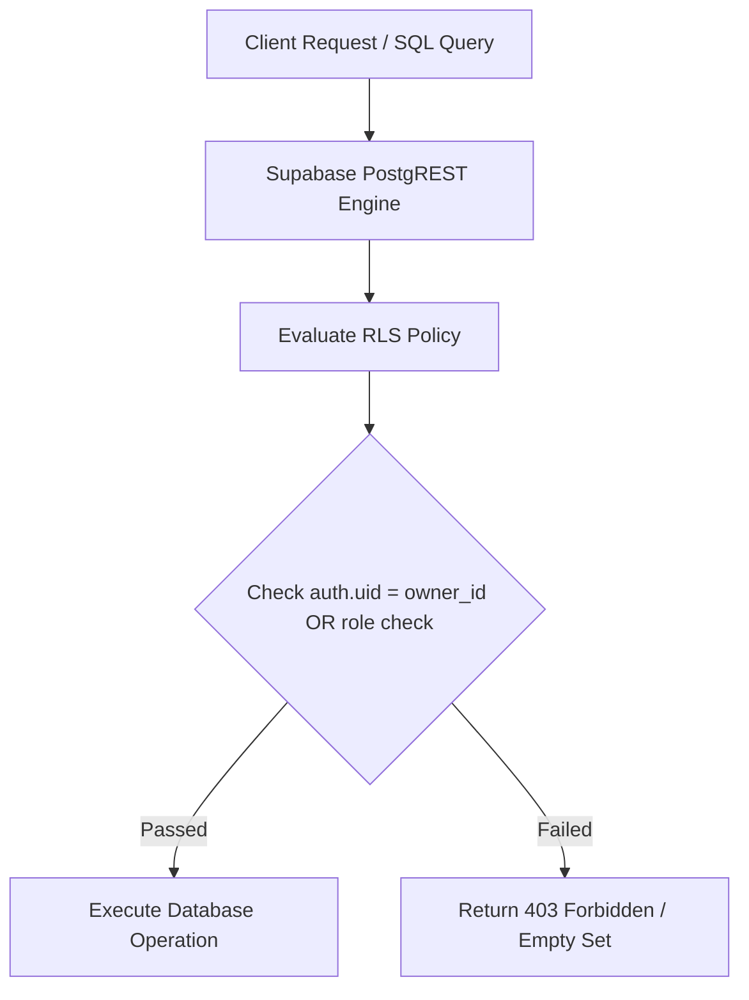

### Table Policy Matrix

| Table | Policy Name | Command | Enforcement Logic |
| :--- | :--- | :---: | :--- |
| `profiles` | Public profile view | SELECT | `true` |
| `profiles` | User update own profile | UPDATE | `auth.uid() = id` |
| `vehicles` | Owner access own vehicles | ALL | `auth.uid() = owner_id` |
| `vehicles` | Mechanic & Insurance view | SELECT | `EXISTS (SELECT 1 FROM profiles WHERE id = auth.uid() AND role IN ('mechanic', 'insurance'))` |
| `service_records` | Owner access service records | ALL | `EXISTS (SELECT 1 FROM vehicles WHERE id = vehicle_id AND owner_id = auth.uid())` |
| `service_records` | Mechanics manage records | ALL | `EXISTS (SELECT 1 FROM profiles WHERE id = auth.uid() AND role = 'mechanic')` |
| `insurance` | Owner view insurance | SELECT | `EXISTS (SELECT 1 FROM vehicles WHERE id = vehicle_id AND owner_id = auth.uid())` |
| `insurance` | Insurance officers manage | ALL | `EXISTS (SELECT 1 FROM profiles WHERE id = auth.uid() AND role = 'insurance')` |
| `fuel_expenses` | Owner manage fuel | ALL | `EXISTS (SELECT 1 FROM vehicles WHERE id = vehicle_id AND owner_id = auth.uid())` |
| `maintenance` | Owner manage maintenance | ALL | `EXISTS (SELECT 1 FROM vehicles WHERE id = vehicle_id AND owner_id = auth.uid())` |
| `garages` | Public garage view | SELECT | `true` |
| `emergency_requests`| Owner manage emergency | ALL | `auth.uid() = owner_id` |
| `emergency_requests`| Mechanics view & update | ALL | `EXISTS (SELECT 1 FROM profiles WHERE id = auth.uid() AND role = 'mechanic')` |

---

## 14. Module-Wise Technical Documentation

### Summary of Modules

1. **Landing Page (`Landing.jsx`)**: Public marketing view with feature list and role entry buttons.
2. **Auth Pages (`Login.jsx`, `Signup.jsx`, `ForgotPassword.jsx`)**: Credential processing and role tab selection.
3. **Owner Dashboard (`owner/Dashboard.jsx`)**: Multi-card metric summaries, active SOS banners, and upcoming task alerts.
4. **Vehicles List (`owner/Vehicles.jsx`)**: Vehicle grid display, Add/Edit modal forms, and deletion handler.
5. **Vehicle Details (`owner/VehicleDetails.jsx`)**: Route-param based tabbed view (`/owner/vehicles/:id`).
6. **Service Management (`owner/Services.jsx`)**: Digital repair log entry and historical record display.
7. **Fuel Expenses (`owner/Fuel.jsx`)**: Fuel expenditure form with automatic calculation and Recharts spend chart.
8. **Maintenance Schedule (`owner/Maintenance.jsx`)**: Task scheduling with automated status calculation.
9. **Insurance Tracking (`owner/Insurance.jsx`)**: Coverage tracking with countdown timer warnings.
10. **Emergency SOS (`owner/Emergency.jsx`)**: GPS location capture modal and dispatch status tracker.
11. **Nearby Garages (`owner/Garages.jsx`)**: Leaflet map render with OpenStreetMap tiles and Google Maps direction links.
12. **Owner Profile (`owner/Profile.jsx`)**: User details and active security overview.
13. **Mechanic Dashboard (`mechanic/Dashboard.jsx`)**: Repair pipeline queue and emergency request counters.
14. **Service Requests (`mechanic/Requests.jsx`)**: Work order status update controls (`Requested` ➔ `In Progress` ➔ `Completed`).
15. **Mechanic Vehicles (`mechanic/Vehicles.jsx`)**: Workshop assigned customer vehicles.
16. **Mechanic Services (`mechanic/Services.jsx`)**: Historical service logs created by technician.
17. **Insurance Dashboard (`insurance/Dashboard.jsx`)**: Policy breakdown cards and policy directory table.
18. **Policy Directory (`insurance/Policies.jsx`)**: Underwriting management and policy issuance form.

---

## 15. Vehicle Management (CRUD)

Vehicle CRUD is implemented in `src/pages/owner/Vehicles.jsx` using `vehicleService.js`.

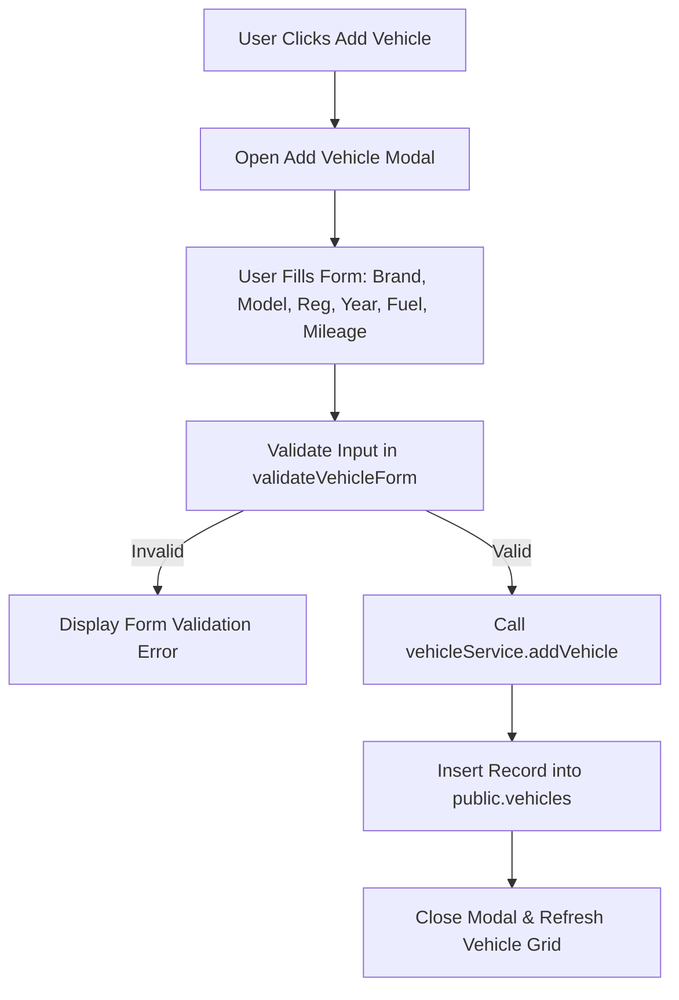

---

## 16. Vehicle Details Architecture

`VehicleDetails.jsx` reads the vehicle ID from the URL path parameter (`/owner/vehicles/:id`) via React Router's `useParams()` hook. It fetches the primary vehicle record and concurrently loads associated service records, fuel fill-ups, maintenance tasks, and insurance policies.

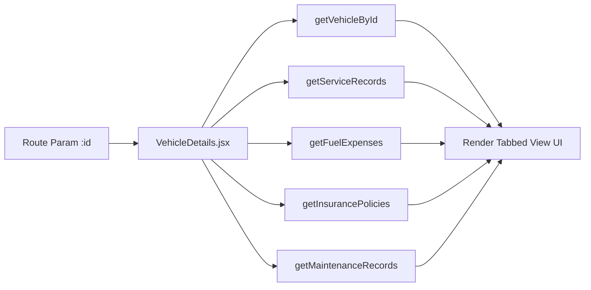

---

## 17. Service Management Workflow

Services can be added by owners or mechanics. Mechanics can transition status from `Requested` ➔ `In Progress` ➔ `Completed`.

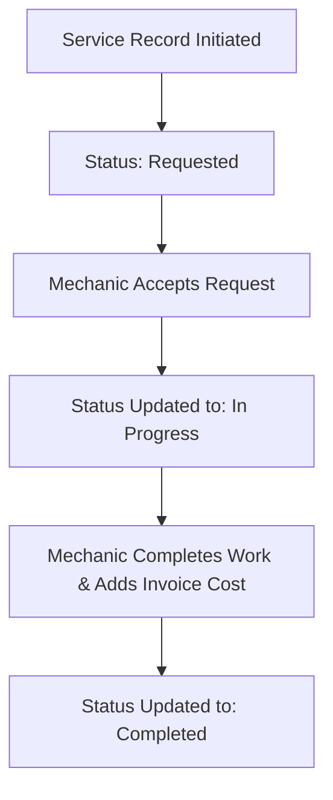

---

## 18. Fuel Expense Management & Analytics

Fuel entries are logged in `src/pages/owner/Fuel.jsx`. The application automatically calculates total cost:

$$\text{Total Cost} = \text{Quantity (Litres)} \times \text{Price Per Litre}$$

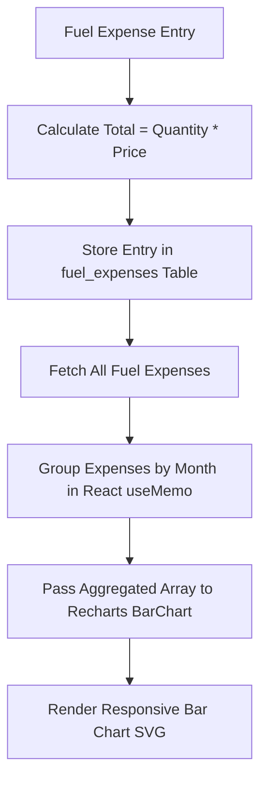

---

## 19. Maintenance Schedule & Status Calculation

Maintenance task status is dynamically calculated in `dateUtils.js` based on the difference between the scheduled due date and current date:

$$\text{Days Remaining} = \left\lceil \frac{\text{Due Date} - \text{Current Date}}{86,400,000} \right\rceil$$

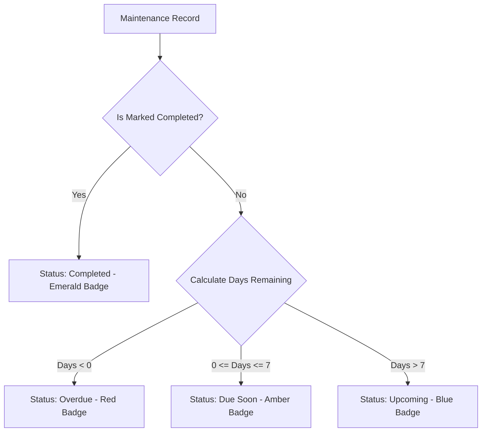

---

## 20. Insurance Tracking & Expiry Logic

Insurance policies are monitored in `dateUtils.js`:

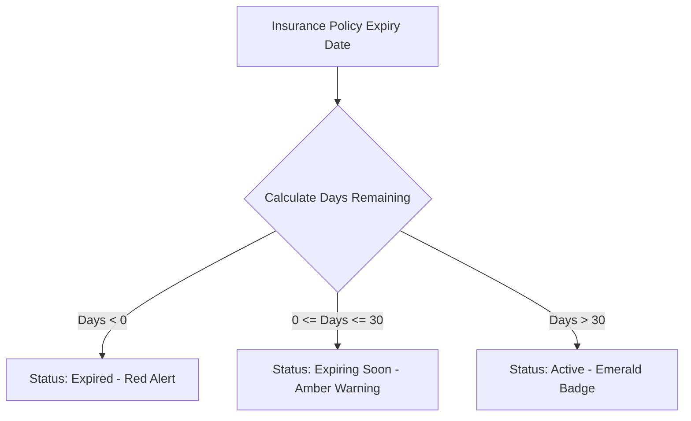

---

## 21. Emergency Assistance & GPS Geolocation

Roadside emergency requests invoke HTML5 `navigator.geolocation.getCurrentPosition()`.

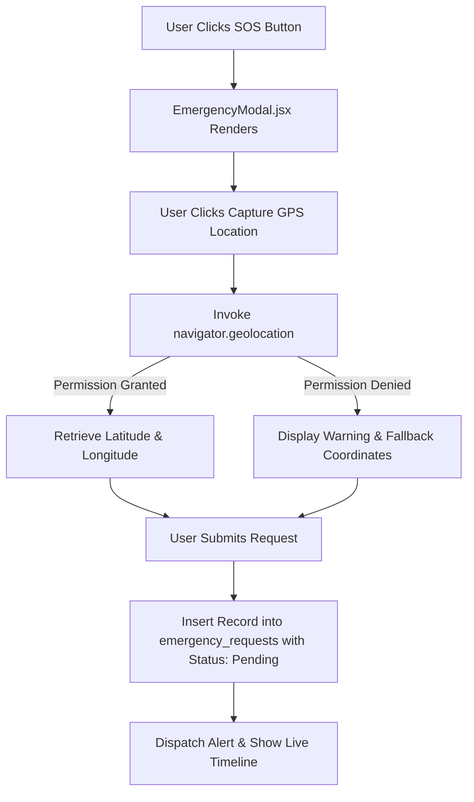

---

## 22. Nearby Garage Finder & Leaflet Maps

`GarageMap.jsx` uses `react-leaflet` and `leaflet` to render an interactive map. Default icon marker paths are dynamically mapped to unpkg CDN assets to prevent broken image icons in Vite production builds.

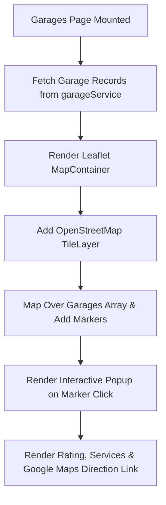

---

## 23. Mechanic & Garage Portal Workflow

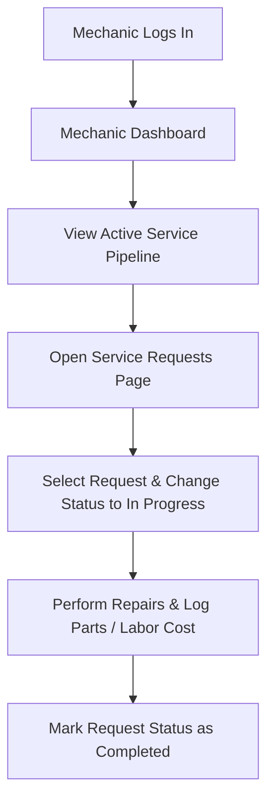

---

## 24. Insurance Company Portal Workflow

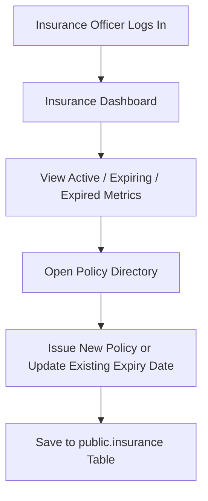

---

## 25. Dashboard Architecture & Calculations

Each dashboard aggregates database state concurrently using `Promise.all()` to minimize total loading latency.

- **Owner Dashboard**:
  - `Total Vehicles` = `vehicles.length`
  - `Fuel Expenses` = $\sum \text{total\_cost}$ across all `fuel_expenses`
  - `Active Insurance` = count of policies where `status === 'Active'`
  - `Maintenance Reminders` = records where `status` is `Due Soon` or `Overdue`

- **Mechanic Dashboard**:
  - `Pending Requests` = count of services where `status IN ('Requested', 'In Progress')`
  - `Completed Services` = count where `status === 'Completed'`

- **Insurance Dashboard**:
  - `Active Policies` = count where `status === 'Active'`
  - `Expiring Soon` = count where `status === 'Expiring Soon'`
  - `Expired` = count where `status === 'Expired'`

---

## 26. Data Flow Diagrams (DFD)

### Level 1 DFD — Vehicle Companion Platform

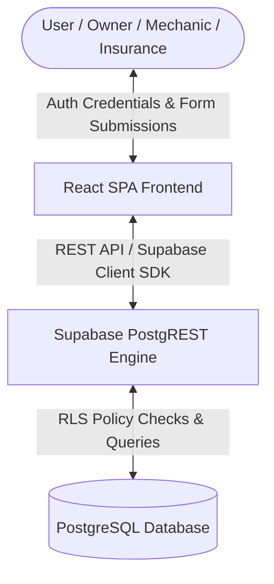

---

## 27. API & Backend Communication Architecture

All frontend database communication is abstracted into service modules inside `src/services/`.

```javascript
// Example Supabase Service Pattern (vehicleService.js)
export const vehicleService = {
  async getVehicles(ownerId) {
    if (isConfigured && supabase) {
      const { data, error } = await supabase
        .from('vehicles')
        .select('*')
        .order('created_at', { ascending: false });
      if (!error && data) return data;
    }
    return getLocalVehicles(); // Fallback demo data
  }
};
```

---

## 28. Business Logic, Methods & Formulas

1. **Fuel Expense Calculation**:
   $$\text{total\_cost} = \text{quantity} \times \text{price\_per\_litre}$$

2. **Date Difference Calculation**:
   $$\Delta t = \left\lceil \frac{T_{\text{target}} - T_{\text{today}}}{86400000} \right\rceil$$

3. **Insurance Status Mapping**:
   $$\text{Status} = \begin{cases} \text{Expired}, & \text{if } \Delta t < 0 \\ \text{Expiring Soon}, & \text{if } 0 \le \Delta t \le 30 \\ \text{Active}, & \text{if } \Delta t > 30 \end{cases}$$

4. **Maintenance Status Mapping**:
   $$\text{Status} = \begin{cases} \text{Completed}, & \text{if } \text{isCompleted} = \text{true} \\ \text{Overdue}, & \text{if } \Delta t < 0 \\ \text{Due Soon}, & \text{if } 0 \le \Delta t \le 7 \\ \text{Upcoming}, & \text{if } \Delta t > 7 \end{cases}$$

---

## 29. Input Validation & Error Handling Strategy

Form input validation is enforced by helper routines in `src/utils/validation.js`:

- `validateVehicleForm`: Verifies brand/model presence, registration length ($\ge 5$), year range ($1900 \le \text{year} \le \text{currentYear} + 1$), and non-negative mileage.
- `validateFuelForm`: Ensures quantity $> 0$, price $> 0$, date presence, and non-negative odometer.
- `validateInsuranceForm`: Ensures start date $<$ expiry date and premium $\ge 0$.
- `validateServiceForm`: Verifies service type, cost $\ge 0$, and service date.

Errors display user-friendly inline alert messages rather than raw database tracebacks.

---

## 30. Project Directory Structure

```text
vehicle-companion/
│
├── public/
├── src/
│   ├── components/
│   │   ├── EmergencyModal.jsx       # GPS location SOS modal
│   │   ├── EmptyState.jsx           # Production empty state view
│   │   ├── ErrorState.jsx           # Error state with retry trigger
│   │   ├── GarageMap.jsx            # Leaflet OpenStreetMap component
│   │   ├── Layout.jsx               # Common App Shell with Navbar & Sidebar
│   │   ├── Loading.jsx              # Loading spinner component
│   │   ├── Navbar.jsx               # Header navigation & role switcher
│   │   ├── ReminderCard.jsx         # Maintenance & Insurance alert card
│   │   ├── ServiceCard.jsx          # Service log card
│   │   ├── Sidebar.jsx              # Role-based sidebar navigation
│   │   ├── StatCard.jsx             # Metric stat card
│   │   └── VehicleCard.jsx          # Vehicle spec overview card
│   │
│   ├── context/
│   │   └── AuthContext.jsx          # Auth provider & profile management
│   │
│   ├── pages/
│   │   ├── ForgotPassword.jsx       # Password reset view
│   │   ├── Landing.jsx              # Public landing page
│   │   ├── Login.jsx                # Login page with role tabs
│   │   ├── Signup.jsx               # Registration page
│   │   ├── insurance/               # Insurance Portal Pages
│   │   │   ├── Dashboard.jsx
│   │   │   ├── Policies.jsx
│   │   │   ├── Profile.jsx
│   │   │   └── Requests.jsx
│   │   ├── mechanic/                # Mechanic Portal Pages
│   │   │   ├── Dashboard.jsx
│   │   │   ├── Profile.jsx
│   │   │   ├── Requests.jsx
│   │   │   ├── Services.jsx
│   │   │   └── Vehicles.jsx
│   │   └── owner/                   # Owner Portal Pages
│   │       ├── Dashboard.jsx
│   │       ├── Emergency.jsx
│   │       ├── Fuel.jsx
│   │       ├── Garages.jsx
│   │       ├── Insurance.jsx
│   │       ├── Maintenance.jsx
│   │       ├── Profile.jsx
│   │       ├── Services.jsx
│   │       ├── VehicleDetails.jsx
│   │       └── Vehicles.jsx
│   │
│   ├── routes/
│   │   ├── AppRoutes.jsx            # Main route definition tree
│   │   ├── ProtectedRoute.jsx       # Unauthenticated user guard
│   │   └── RoleRoute.jsx            # Role authorization guard
│   │
│   ├── services/
│   │   ├── emergencyService.js      # Emergency API service
│   │   ├── fuelService.js           # Fuel API service
│   │   ├── garageService.js         # Garage API service
│   │   ├── insuranceService.js      # Insurance API service
│   │   ├── maintenanceService.js    # Maintenance API service
│   │   ├── serviceRecordService.js  # Service Record API service
│   │   ├── supabase.js              # Supabase Client initialization
│   │   └── vehicleService.js        # Vehicle CRUD service
│   │
│   ├── utils/
│   │   ├── calculations.js          # Currency & cost formulas
│   │   ├── dateUtils.js             # Date status calculators
│   │   ├── seedData.js              # Seed data array (30 Users)
│   │   └── validation.js            # Input validation functions
│   │
│   ├── App.jsx                      # App root component
│   ├── index.css                    # Tailwind CSS imports & custom styles
│   └── main.jsx                     # DOM entry point
│
├── .env.example                     # Environment template
├── .gitignore                    # Git ignore file
├── DEMO_USERS.example.md            # Demo credentials structure template
├── index.html                       # Base HTML file with Leaflet CSS
├── package.json                     # Dependencies & build scripts
├── postcss.config.js                # PostCSS configuration
├── README.md                        # Complete Technical Documentation
├── seed-demo-users.js               # Idempotent Node seeder script
├── supabase_schema.sql              # Database schema & RLS policies
├── tailwind.config.js               # Tailwind CSS theme configuration
└── vite.config.js                   # Vite configuration
```

---

## 31. Environment Variables & Credentials Security

Environment variables are managed via `.env` files using Vite's `VITE_` prefix:

```env
# Local Environment Variables (.env)
VITE_SUPABASE_URL=https://aoyvyedzgimjbyyoajkv.supabase.co
VITE_SUPABASE_ANON_KEY=sb_publishable_Gui9MqlYo6ARJHu3NWwmrQ_3lGmMfAZ
```

> [!IMPORTANT]
> Frontend code uses only the public anon key (`VITE_SUPABASE_ANON_KEY`). The `SUPABASE_SERVICE_ROLE_KEY` is restricted strictly to local admin scripts (`seed-demo-users.js`) and is never committed to GitHub or exposed in web browser builds.

---

## 32. Local Setup & Installation Guide

1. **Clone Repository**:
   ```bash
   git clone https://github.com/Surajsaw-git/VehicleCompanion.git
   cd vehicle-companion
   ```

2. **Install Dependencies**:
   ```bash
   npm install
   ```

3. **Configure Environment**:
   Copy `.env.example` to `.env` and fill in your Supabase credentials:
   ```bash
   cp .env.example .env
   ```

4. **Start Development Server**:
   ```bash
   npm run dev
   ```

5. **Open Browser**:
   Navigate to `http://localhost:3000`.

---

## 33. Database Provisioning & SQL Setup

1. Log into your [Supabase Dashboard](https://supabase.com).
2. Open your project and navigate to the **SQL Editor**.
3. Copy the contents of [`supabase_schema.sql`](file:///c:/PROJECT/vehicle-companion/supabase_schema.sql).
4. Paste into the SQL Editor and click **Run**.
5. Verify that all 8 tables (`profiles`, `vehicles`, `service_records`, `insurance`, `fuel_expenses`, `maintenance`, `garages`, `emergency_requests`) and RLS policies are created.

---

## 34. Production Deployment (Vercel)

The application is deployed on Vercel:

1. **Git Commit & Push**:
   ```bash
   git add .
   git commit -m "Deploy production build"
   git push origin main
   ```

2. **Vercel Project Configuration**:
   - **Framework Preset**: Vite
   - **Build Command**: `npm run build`
   - **Output Directory**: `dist`

3. **Environment Variable Setup**:
   Configure `VITE_SUPABASE_URL` and `VITE_SUPABASE_ANON_KEY` in Vercel settings.

---

## 35. Production Build & Verification Results

The project build was verified locally using `npm run build`:

```text
> vehicle-companion@1.0.0 build
> vite build

vite v5.4.21 building for production...
transforming...
✓ 2442 modules transformed.
rendering chunks...
computing gzip size...
dist/index.html                     0.74 kB │ gzip:   0.47 kB
dist/assets/index-D4VWz5Wi.css     34.90 kB │ gzip:   6.30 kB
dist/assets/index-lgckr-I1.js   1,091.42 kB │ gzip: 295.87 kB
✓ built in 4.96s
```
- **Exit Code**: `0` (Success)

---

## 36. Complete Testing Strategy & Matrix

| Test Suite | Execution Type | Status | Result |
| :--- | :---: | :---: | :--- |
| **Vite Bundle Build** | Automated CLI | Implemented & Verified | Exit Code 0 |
| **Owner Auth Login** | Manual & Script | Implemented & Verified | Redirects to `/owner/dashboard` |
| **Mechanic Auth Login** | Manual & Script | Implemented & Verified | Redirects to `/mechanic/dashboard` |
| **Insurance Auth Login** | Manual & Script | Implemented & Verified | Redirects to `/insurance/dashboard` |
| **Vehicle CRUD** | Manual Browser | Implemented & Verified | Inserts & updates display in grid |
| **Fuel Calculation** | Unit Formula | Implemented & Verified | `35L * ₹102 = ₹3,570` accurate |
| **Maintenance Status** | Date Utility | Implemented & Verified | Displays `Due Soon` / `Overdue` |
| **Insurance Expiry** | Date Utility | Implemented & Verified | Displays `Expiring Soon` / `Expired` |
| **GPS Geolocation** | Browser API | Implemented & Verified | Captures latitude & longitude |
| **Leaflet Garage Map** | Interactive UI | Implemented & Verified | Renders map markers & popups |

---

## 37. Security Architecture

1. **Authentication**: Handled by Supabase Auth engine issuing JWT tokens.
2. **Database Authorization**: Enforced by PostgreSQL Row Level Security (RLS) restricting query execution based on `auth.uid()`.
3. **Frontend Guarding**: Dual-layer routing protection with `ProtectedRoute` and `RoleRoute`.
4. **Secret Isolation**: `SUPABASE_SERVICE_ROLE_KEY` is omitted from frontend bundles.

---

## 38. Responsive Design & Mobile Usability

The user interface uses Tailwind CSS breakpoints (`sm:`, `md:`, `lg:`) to adjust across screen sizes:
- **Mobile (< 768px)**: Collapsible sidebar overlay drawer, single-column stat cards, touch-friendly emergency SOS buttons.
- **Tablet (768px - 1024px)**: 2-column grid cards and scrollable table views.
- **Desktop (> 1024px)**: Fixed side navigation layout with expanded analytics dashboards.

---

## 39. Complete User Journeys

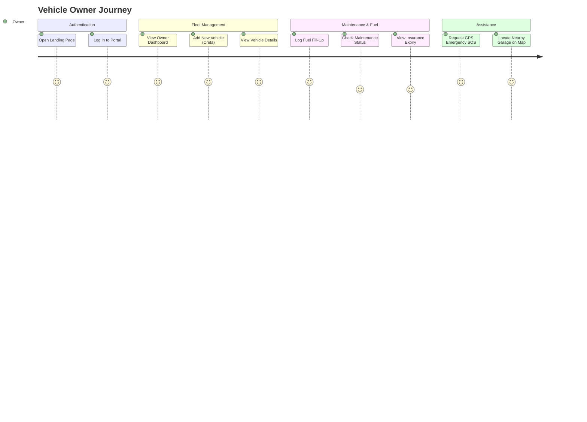

---

## 40. Mermaid System Flowcharts Directory

The documentation includes complete Mermaid flowcharts for:
1. Overall System Architecture
2. Complete Application Flow
3. Authentication & Role Switcher Flow
4. Row Level Security Execution Flow
5. Vehicle CRUD Operation Flow
6. Vehicle Details Fetch Flow
7. Service Request Status Transition Flow
8. Fuel Expense Calculation & Recharts Flow
9. Maintenance Status Date Decision Flow
10. Insurance Expiry Warning Decision Flow
11. GPS Emergency Geolocation Capture Flow
12. Leaflet Garage Map Render Flow
13. Mechanic Service Pipeline Flow
14. Insurance Officer Policy Management Flow
15. DFD Level 1 System Data Flow
16. User Experience Journey Map

---

## 41. External Services Integration

- **Supabase Cloud**: Authentication provider and PostgreSQL host.
- **OpenStreetMap**: Map graphics tile service.
- **Google Maps**: External navigation routing via URL scheme (`https://www.google.com/maps/dir/?api=1&destination=lat,lng`).
- **Vercel**: Static SPA hosting platform.

---

## 42. Limitations

1. **Simulated Emergency Dispatch**: Emergency requests capture live GPS coordinates and create database records, but do not dispatch real towing services.
2. **Third-Party Telematics**: OBD-II real-time engine diagnostics are not included in the current MVP scope.
3. **Payment Gateways**: Service invoices display cost totals but do not process real credit card payments.

---

## 43. Future Roadmap & Enhancements

1. **AI Predictive Maintenance**: Machine learning models to forecast component failure based on mileage and driving history.
2. **Push Notifications**: Web push & SMS alerts for upcoming maintenance and insurance expiry.
3. **OBD-II IoT Integration**: Bluetooth scanner connection to stream live engine fault codes.
4. **Payment Gateway Integration**: Razorpay / Stripe integration for paying garage invoices online.

---

## 44. Advantages & Practical Benefits

- **Zero Paperwork**: Replaces physical glovebox service books with digital cloud records.
- **Financial Control**: Tracks fuel spending patterns and maintenance costs over time.
- **Breakdown Safety**: Instantly captures exact location coordinates during roadside emergencies.
- **Legal Compliance**: Early policy expiry warnings prevent driving with lapsed insurance.

---

## 45. Use Cases & Walkthroughs

### Use Case 1: Owner Adds Fuel Expense
1. Owner opens `/owner/fuel` and clicks **Log Fuel Fill-Up**.
2. Selects vehicle, enters 35 Litres at ₹102/Litre, and enters current odometer reading.
3. System calculates Total Cost = ₹3,570.
4. Entry saves to Supabase `fuel_expenses` table.
5. Recharts bar chart automatically updates monthly totals.

---

## 46. Input ➔ Process ➔ Output (IPO) Matrix

| Module | Input | Processing | Database Table | Output |
| :--- | :--- | :--- | :--- | :--- |
| **Auth** | Email, Password | Supabase Auth Verification | `auth.users`, `profiles` | JWT Session & Role |
| **Vehicle** | Brand, Model, Reg, Year, Fuel, Mileage | Validation & Insertion | `vehicles` | Vehicle Card & Grid |
| **Fuel** | Quantity, Price/Litre, Date, Odometer | $\text{Cost} = Q \times P$ | `fuel_expenses` | Expense Log & Recharts |
| **Maintenance** | Type, Due Date, Description | Date Diff Calculation | `maintenance` | Status Badge (`Due Soon`) |
| **Insurance** | Policy #, Dates, Premium | Expiry Countdown | `insurance` | Expiry Badge (`Active`) |
| **Emergency** | Issue, Description, Device Location | Geolocation API Capture | `emergency_requests` | SOS Timeline & Coordinates |

---

## 47. Technical Glossary

- **React**: Declarative component-based UI library.
- **Vite**: Modern frontend build tool.
- **Supabase**: Managed backend platform providing PostgreSQL and Auth.
- **RLS (Row Level Security)**: Database security enforcement inside PostgreSQL.
- **Recharts**: Modular SVG charting library.
- **Leaflet**: Open-source interactive map rendering engine.
- **OpenStreetMap**: Community map tile provider.
- **SPA (Single Page Application)**: Web app that dynamically rewrites the current page without full browser reloads.

---

## 48. Viva & Presentation Q&A Guide

### Q1: How is data secured between different vehicle owners?
**Answer**: Security is enforced at the database level using PostgreSQL **Row Level Security (RLS)** policies. Policies evaluate `auth.uid() = owner_id`, ensuring users can query or modify only their own data.

### Q2: How does the application calculate maintenance status?
**Answer**: Status is calculated dynamically in `dateUtils.js` by computing the difference in days between the scheduled due date and the current date. Tasks due within 7 days are flagged as `Due Soon`, past dates as `Overdue`, and completed tasks as `Completed`.

### Q3: How are fuel analytics rendered?
**Answer**: Fuel entries are aggregated by month using JavaScript array reduction (`useMemo`). The aggregated monthly totals are passed to **Recharts**, which renders responsive SVG bar charts.

---

## 49. Key Code Snippets

```javascript
// Date Status Calculation (src/utils/dateUtils.js)
export function getMaintenanceStatus(dueDateString, isCompleted = false) {
  if (isCompleted) {
    return { status: 'Completed', badgeClass: 'bg-emerald-100 text-emerald-700 border-emerald-200' };
  }
  const days = getDaysRemaining(dueDateString);
  if (days < 0) return { status: 'Overdue', badgeClass: 'bg-red-100 text-red-700 border-red-200', days };
  if (days <= 7) return { status: 'Due Soon', badgeClass: 'bg-amber-100 text-amber-700 border-amber-200', days };
  return { status: 'Upcoming', badgeClass: 'bg-blue-100 text-blue-700 border-blue-200', days };
}
```

---

## 50. Project Status & Quick Reference

### Project Status

- **Development Status**: Complete Production MVP
- **Build Status**: Verified (`vite build` exit code `0`)
- **Database Status**: PostgreSQL Schema & RLS Policies Applied
- **Seed Data Status**: 30 Permanent Demo Accounts Provisioned

### Quick Reference

| Component | Technology |
| :--- | :--- |
| **Frontend** | React 18 + Vite |
| **Styling** | Tailwind CSS |
| **Backend** | Supabase (PostgreSQL 15) |
| **Authentication** | Supabase Auth Engine |
| **Security** | Row Level Security (RLS) |
| **Analytics** | Recharts |
| **Maps** | Leaflet + OpenStreetMap |
| **Deployment** | Vercel |
